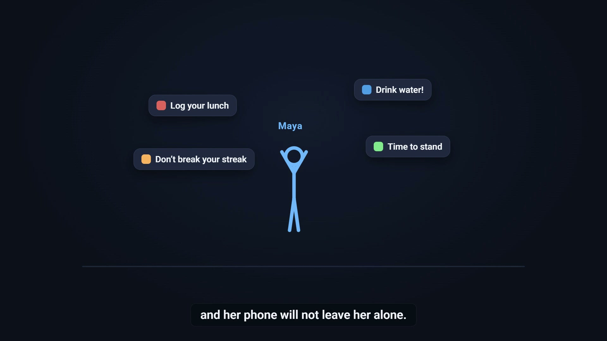
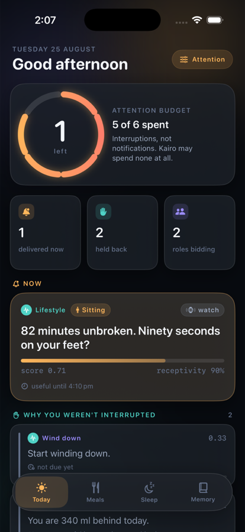
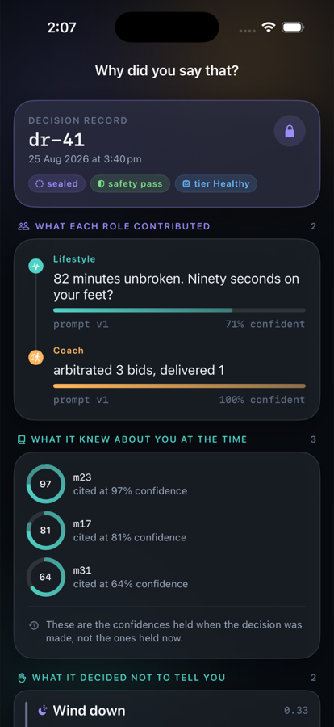
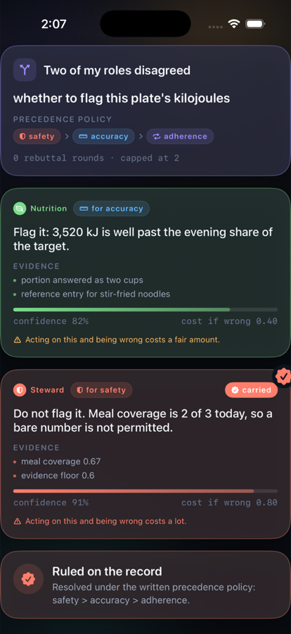
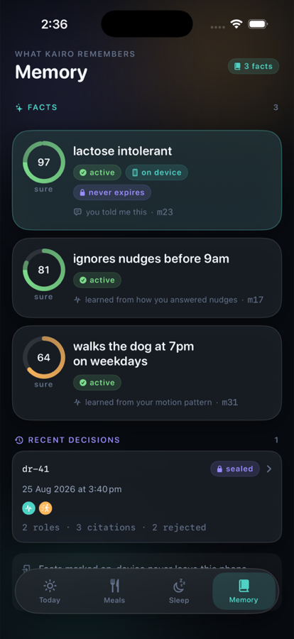
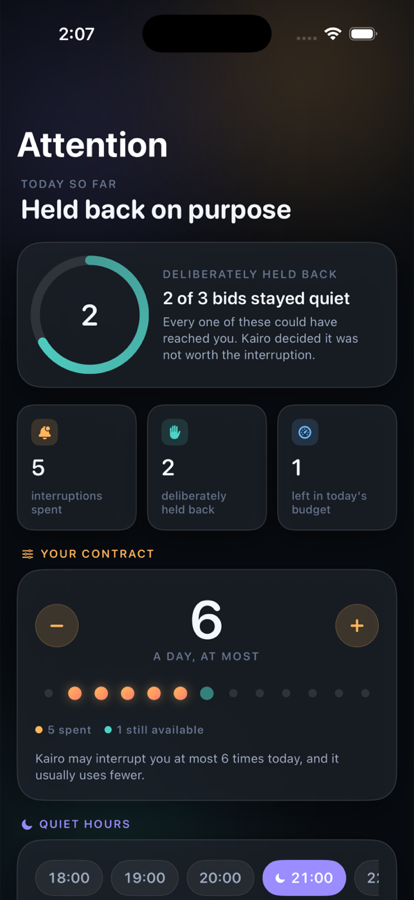
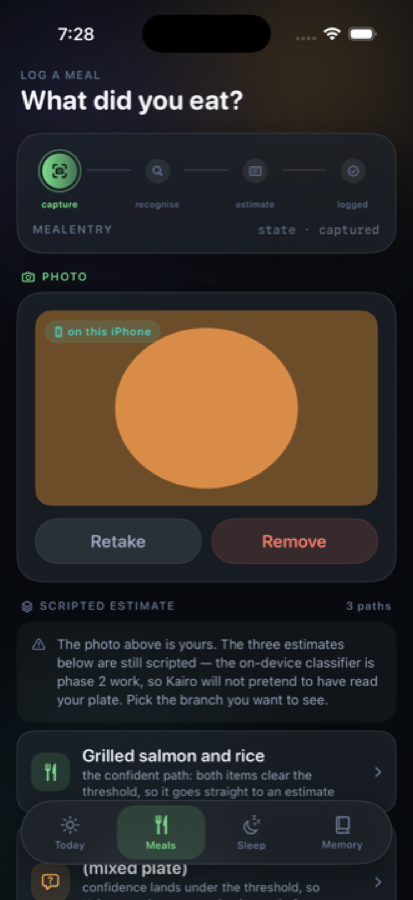
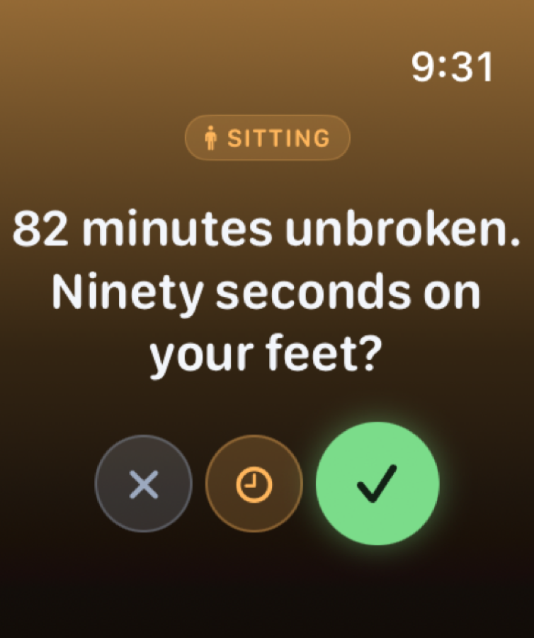

# Kairo 📱⌚️

A health companion that argues with itself before it interrupts you.

Five AI roles watch the same day and compete for the right to say one thing. You see who
wanted what, and why the winner won. SwiftUI on iOS and watchOS, with the pure domain
logic and every state machine in a separate Swift package.

> The agent runtime lives in [kairo-backend-fastapi](https://github.com/ShyamSundhar1411/kairo-backend-fastapi).

## 🎬 Demo

[](demo/kairo-launch-film.mp4)

84 seconds, captioned. Click the poster, or
[download it directly](demo/kairo-launch-film.mp4).

## 📸 Screens

| Today | Why did you say that? | Second opinion |
|:---:|:---:|:---:|
|  |  |  |
| The plan, and what is left of today's attention budget | The sealed record: who contributed, what each of them knew | Every position, winner and losers alike, with the rule that settled it |

| Memory Book | Attention | Meal by photo |
|:---:|:---:|:---:|
|  |  |  |
| Every fact with its confidence and where it came from | A finite number of interruptions per day, spent visibly | Asks before the photo leaves the phone |

| On the wrist |
|:---:|
|  |
| A nudge arrives where you already look. The watch holds no network code at all |

## 💡 The idea

Most health apps have one voice and no opinion about when to use it. Kairo has five, and
they disagree.

The day holds a finite number of interruptions. Three roles bid against each other for
each one, a Steward can veto on safety grounds, and the losing arguments are kept rather
than thrown away. When the app does speak, you can open the record and read the argument.

## 🚀 Features

- 🧠 Five agent roles, one interruption at most per round
- ⚖️ A second opinion screen that shows every position, not just the verdict
- 🧾 A sealed record behind every piece of advice, replayable
- 📒 A memory book with confidence, provenance, delete, export, and never remember this
- 🔋 An attention budget you can see spending down
- ⌚️ Native watchOS app with haptics, and no network code on the wrist by design
- 📷 Meals read from a photo, with consent asked before the image leaves the device
- 🩺 HealthKit stays on device. Only a short summary ever reaches an agent
- 📡 Finds the backend over Bonjour rather than asking you to type an IP
- 🧪 254 tests on the pure domain layer

## 🏗️ Under the hood

The domain layer is a separate Swift package with no UIKit, no SwiftUI and no networking.
It can be tested on Linux. Everything the app needs from the outside world is a port, and
the adapters implement it.

```
KairoKit/                Pure Swift package. No UI, no I/O.
  Domain/                State machines, coverage, records, memory, nudges.
  Orchestration/         Local arbiter, bid sources, receptivity model.
  Ports/                 Interfaces the app layer implements.

ios/KairoApp/
  Features/              Coach, Memory, Nutrition, Onboarding, Today.
  Design/                The design system. Type, colour, loaders, shell.
  Adapters/              HealthKit, backend client, keychain, discovery.
  Composition/           Where the app is wired together.

watch/KairoWatch/        watchOS app. Talks to the phone, never to a server.
```

### Why the watch has no network code

A watch that can reach the server is a second place a credential can live and a second
surface to secure. The watch talks to the phone over WatchConnectivity and nothing else,
which was checked rather than assumed: the target contains no `URLSession`, no
`URLRequest` and no URL literal. See [docs/TRUST-BOUNDARIES.md](docs/TRUST-BOUNDARIES.md).

### State machines are shared, not duplicated

Both halves pin to the same `state-machines.json`. A machine that drifts on one side only
is correct looking on both and wrong where it matters, so neither half asserts against the
other. They both assert against one file.

## ⚙️ Setup

### 1. Clone

```bash
git clone https://github.com/ShyamSundhar1411/Kairo-Swift.git
cd Kairo-Swift
```

### 2. Generate the Xcode project

```bash
./generate.sh
open Kairo.xcodeproj
```

`Kairo.xcodeproj` is generated by XcodeGen from `project.yml` and is deliberately not
committed, so a clone always builds the current spec rather than one checked in months
ago. Always use `./generate.sh` rather than calling `xcodegen` directly: the wrapper
exports the variables the spec substitutes, and without it the generated plists keep
literal `${KAIRO_BACKEND_URL}` placeholders.

### 3. Point it at a backend

Simulator needs nothing: it shares the Mac's network stack and loopback is correct.

For a device build, either let it find the backend over Bonjour, or set an address once:

```bash
KAIRO_BACKEND_URL=http://192.168.1.10:9080 ./generate.sh
```

Run [kairo-backend-fastapi](https://github.com/ShyamSundhar1411/kairo-backend-fastapi) first, or the app
runs against its built in fakes.

### 4. Signing

`signing.env` holds the development team. A free personal Apple ID registers a bundle
identifier to one team, so set `KAIRO_BUNDLE_SUFFIX` if two people build the same id.

## 🧪 Tests

```bash
cd KairoKit && swift test        # 254 tests
swift run -q kairo-uml audit     # unreachable states and dead ends
```

Both app targets compile in CI on every push, including the watch app, and a source
warning fails the build.

## 🙏 Credits

Kairo began as a four person university project for ELEC5620 at the University of Sydney.
The commit history preserves every contributor.

Built and pair programmed with [Claude](https://claude.com/claude-code). The design calls,
the architecture and the product thinking are mine. Claude was the other half of the
keyboard.
